

  

  

  
  
  
  

  
  

  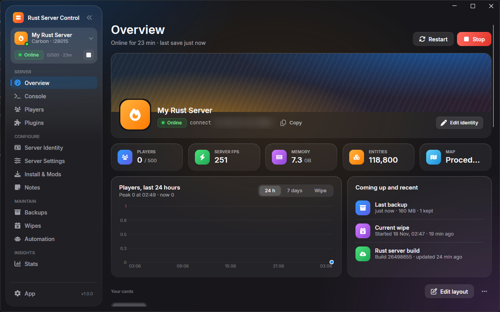

## What it is

A Windows app that installs, runs and manages a Rust dedicated server. One exe, no installer, no .NET to hunt down.

Hosting Rust on Windows usually means a SteamCMD window, a batch file, an RCON tool, a text file full of convars and a backup folder you meant to keep up to date. This puts all of that in one window. It does not play Rust for you. That part is still your job.

## What it does

| | |
|---|---|
| **Install and update** | Rust Dedicated, Carbon or Oxide through SteamCMD, with branch selection. |
| **Live console** | Server output with filters, search and command autocomplete. |
| **Players** | Players, chat and bans over RCON. |
| **Plugins** | Add, reload, read compiler errors, browse uMod. |
| **Server settings** | Search, presets and a check of the final launch line. |
| **Server identity** | Name, description, logo and banner, with a live server browser preview. |
| **Backups and wipes** | Backups, scheduled wipes and automation tasks. |
| **Stats** | CPU, memory, FPS and player graphs, plus a kill/death leaderboard. |
| **Languages** | English and Turkish. |

  
  

## Quick start

**1. Download and run.** Extract the zip into an empty folder, for example `D:\RustServer`, and run `RustServerControl.exe`. Servers, SteamCMD, backups and settings live in that folder. Move the folder and everything moves with it.

**2. Create a server.** Click **Create server**. Pick a name, a folder, a framework (Vanilla, Carbon or Oxide) and the ports.

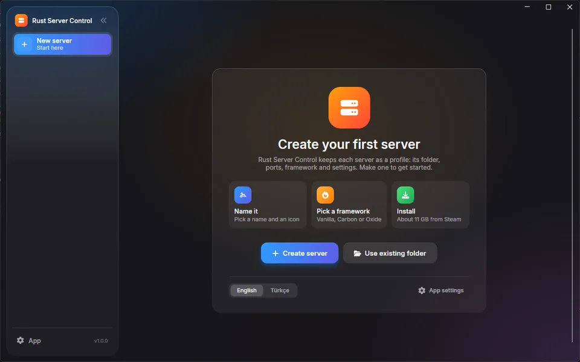

**3. Install.** Click **Install Rust server**. SteamCMD downloads the server (about 6 GB) and the framework. This is the slow part. Make a tea.

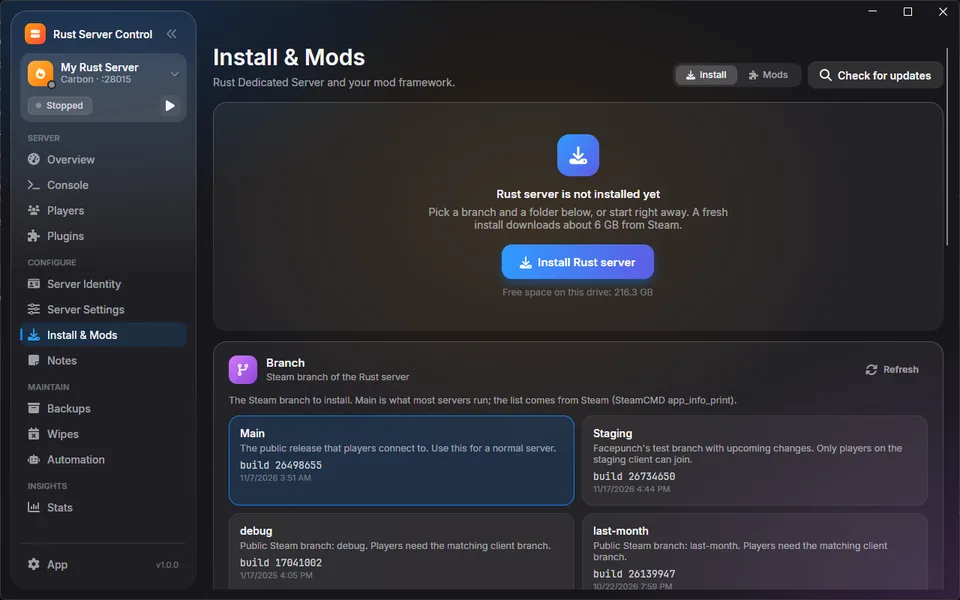

**4. Start.** Press **Start**. The console, players and plugins are live once the server is online.

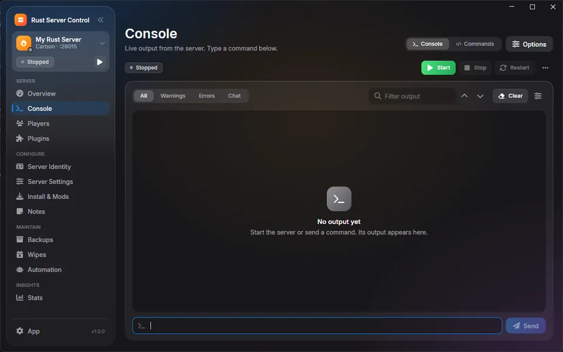

## Screenshots

| Players | Plugins |
|---|---|
| 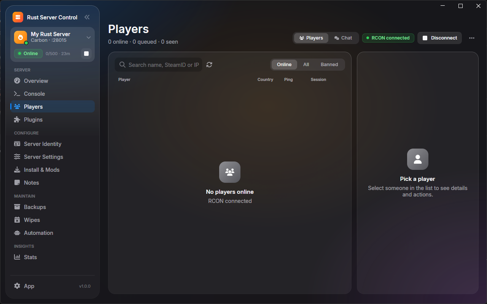 | 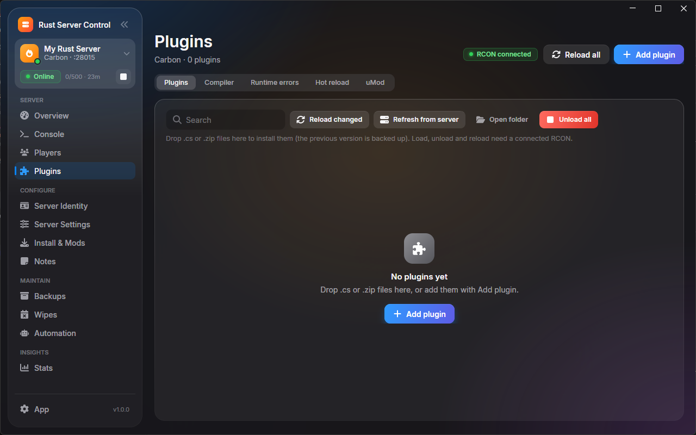 |
| **Server settings** | **Backups** |
| 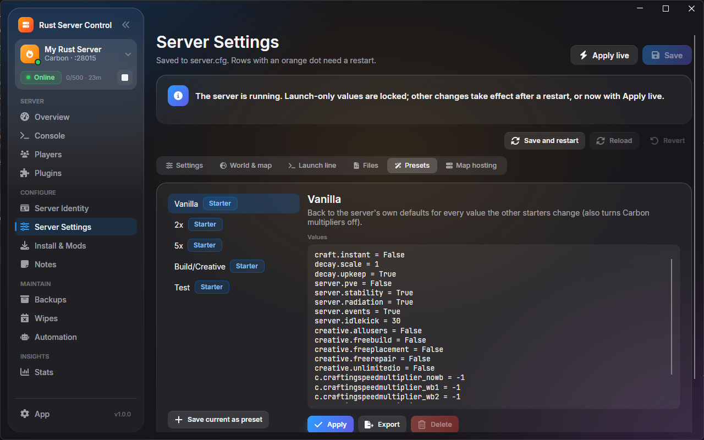 | 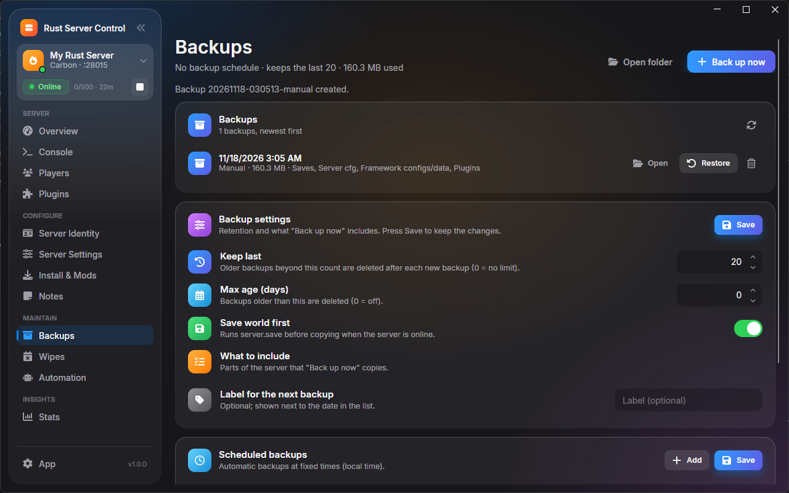 |
| **Server identity** | **Stats** |
| 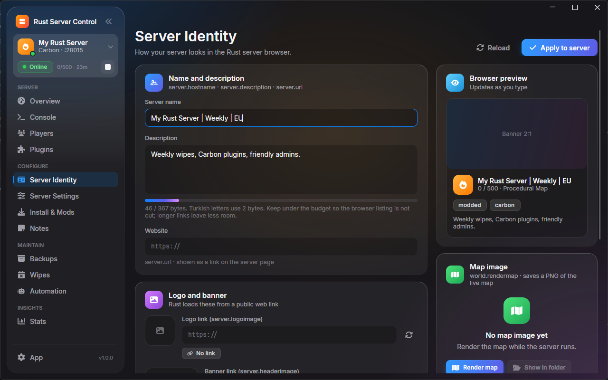 | 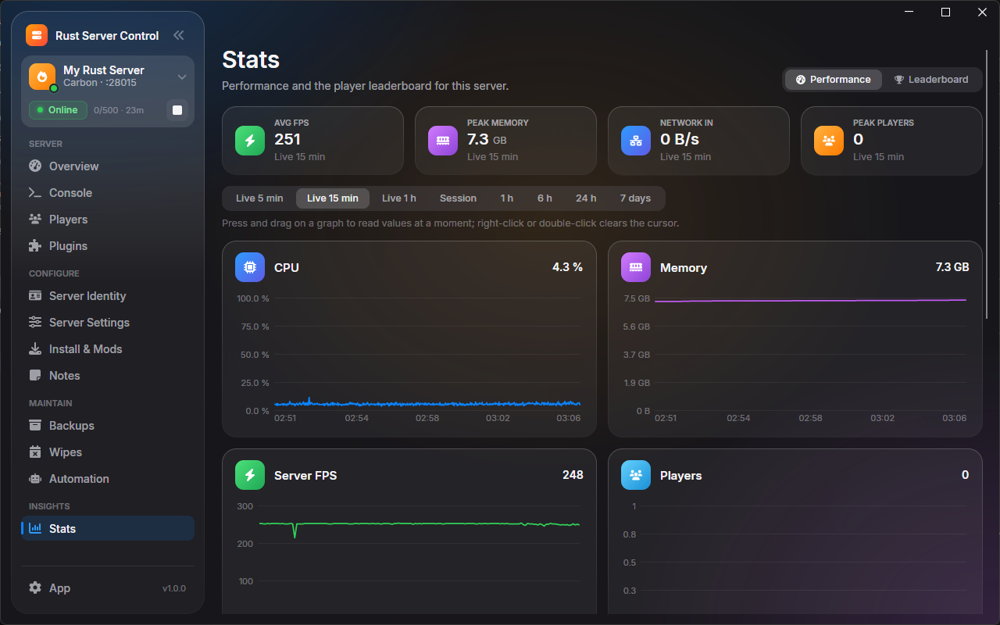 |

## Requirements

- Windows 10 or 11, 64-bit.
- About 12 GB free disk space per server.

That is the list.

## Good to know

- Everything is stored in the exe's folder.
- RCON listens on 127.0.0.1 by default, so only this PC can connect.
- Players cannot join? Open the game port (UDP 28015 by default) and the query port in your router and Windows Firewall.

  
  
  

## Licence

Free to use, for private and commercial hosting. Not for resale or redistribution. See [LICENSE](LICENSE).

Unofficial tool. Not affiliated with or endorsed by Facepunch Studios. Rust is a trademark of Facepunch Studios.

  

